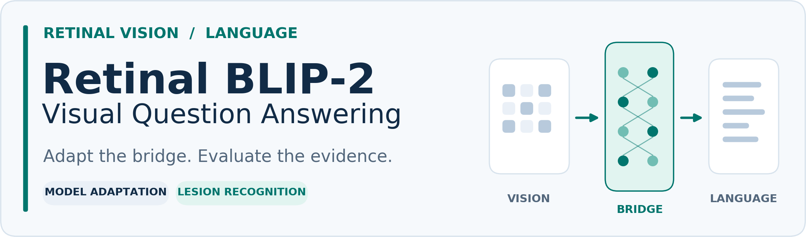
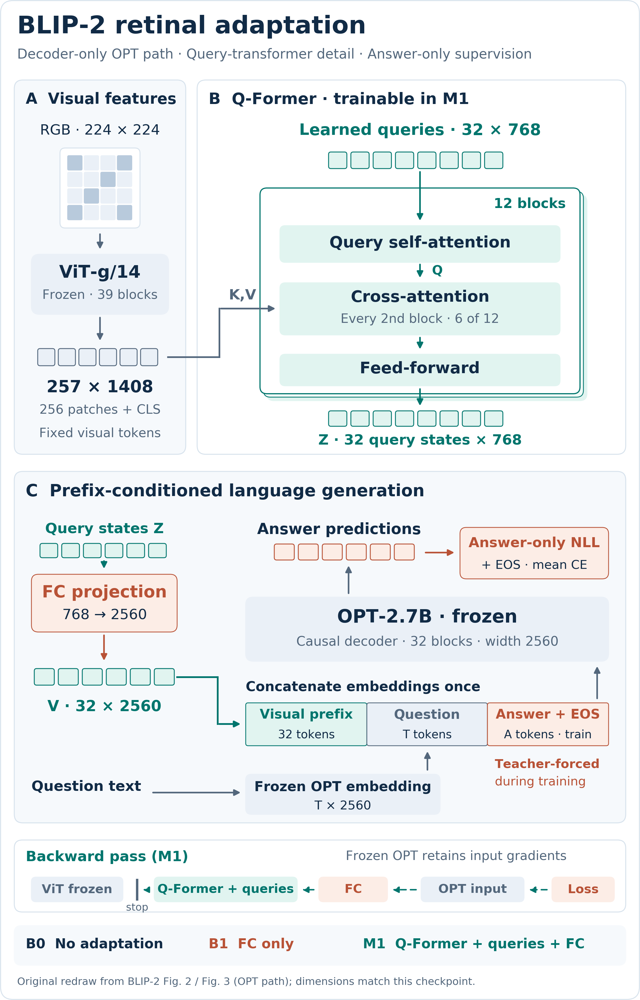
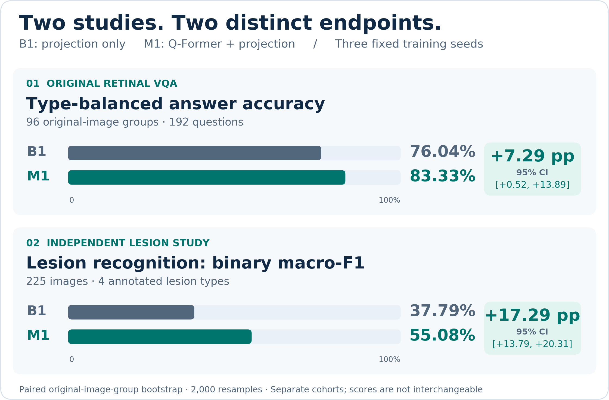

<p align="center">
  
</p>

<p align="center">
  <strong>面向视网膜图像问答的视觉语言模型适配</strong><br />
  冻结视觉与语言主干 · 公平的模型对照 · 独立病灶识别评测
</p>

<p align="center">
  <a href="README.md">English</a> · 简体中文 ·
  <a href="docs/study.md">研究设计</a> ·
  <a href="docs/results.md">实验结果</a> ·
  <a href="docs/reproducibility.md">复现指南</a> ·
  <a href="docs/data.md">数据与获取</a>
</p>

---

## 这个项目在做什么

只调整预训练视觉模型与语言模型之间的连接，能否让模型更会回答视网膜图像问题？问答成绩提高以后，它是否也更能认出有真实标注的病灶？

本项目以 **BLIP-2** 为基础，保留视觉编码器和语言模型的参数，适配两者之间的视觉语言连接模块。我们分别开展了视网膜问答实验和独立病灶实验，把**答题表现**与**病灶识别表现**分开检验。

- **比较不同适配方式：**原模型、只训练投影层、联合训练视觉桥接模块与投影层。
- **用真实标注检验病灶：**根据四类病灶分割掩码判断整图是否存在病灶；缺少掩码不当作没有病灶。
- **让结果可以核查：**固定重复种子、按原图分组、冻结评测规则、独立重算指标，并重新加载关键模型验证推理结果。

## 方法

<p align="center">
  <picture>
    <source media="(max-width: 640px)" srcset="assets/method-mobile.png" />
    
  </picture>
</p>

*基于 [BLIP-2 论文图 2–3](https://proceedings.mlr.press/v202/li23q/li23q.pdf) 的 Q-Former 与解码器结构重新绘制，展开本项目的适配位置和答案监督。[查看高清矢量图 →](assets/method.svg)*

| 模型 | 训练哪些部分 | 作用 |
| :--- | :--- | :--- |
| **B0** | 不训练 | 原始 BLIP-2 基线 |
| **B1** | 图像到语言的投影层 | 只训练投影的对照 |
| **M1** | Q-Former、查询向量与投影层 | 联合适配视觉语言连接 |

语言模型的参数保持冻结，但保留从答案损失到视觉前缀的梯度通路；视觉编码器也始终冻结。[查看实现与评测设计 →](docs/study.md)

## 主要发现

<p align="center">
  <picture>
    <source media="(max-width: 640px)" srcset="assets/results-mobile.png" />
    
  </picture>
</p>

| 评测 | B1 | M1 |
| :--- | ---: | ---: |
| 原问答 · 准确率 | 76.04% | **83.33%** |
| 独立病灶识别 · 宏平均 F1 | 37.79% | **55.08%** |

**两行来自不同数据，使用不同指标。**问答实验包含96组原图、192道题；病灶实验包含225张图、四类病灶。表中为相同三个训练种子（17、29、43）的均值。病灶指标先对每种病灶的正、负两类 F1 等权平均，再对四种病灶平均，不能称为准确率。图中的95%区间来自2,000次按原图分组的配对自助抽样。

这些发现对应上述具体任务与指标。[查看指标定义、比较范围和核查依据 →](docs/results.md)

特征探针与分阶段证据实验见[研究说明](docs/study.md)。分阶段实验使用明确的计数与布尔规则；真正的医学条件推理，还需要完整病灶证据与独立专业核验的医学答案。

## 开始使用

```bash
python -m pip install \
  -e '.[dev,figures]'
python -m pytest -q
```

训练或推理前，请按各自许可获取原始数据和预训练模型，再按照[复现指南](docs/reproducibility.md)配置本地路径并运行。公开仓库提供代码、配置、汇总结果和制图来源；医学影像、受限标注及模型权重需单独获取。

```bash
# 根据真实汇总结果重画图表。
python tools/build_figures.py
```

## 从这里继续阅读

| 资料 | 内容 |
| :--- | :--- |
| [研究设计](docs/study.md) | 模型适配、数据角色、特征探针和分阶段证据实验 |
| [实验结果](docs/results.md) | 指标定义、样本数量与有证据支持的比较 |
| [数据与获取](docs/data.md) | 官方来源、标注含义与合法获取方法 |
| [复现指南](docs/reproducibility.md) | 环境、配置和实际运行流程 |
| [核查依据](docs/evidence.md) | 来源哈希、独立核算和公开版本的溯源 |
| [机器可读结果](results/main_results.json) | 首页与图表使用的汇总数值 |

## 致谢与使用条款

本项目基于 [BLIP-2](https://proceedings.mlr.press/v202/li23q.html) 及 [Salesforce 发布的预训练模型](https://huggingface.co/Salesforce/blip2-opt-2.7b)。视网膜任务和病灶标注的来源见[数据与获取](docs/data.md)。

代码、模型和数据各自的适用条款见 [LICENSE](LICENSE) 与[第三方说明](THIRD_PARTY.md)。本仓库展示的是模型适配与评测研究，现有证据尚不构成临床验证。
